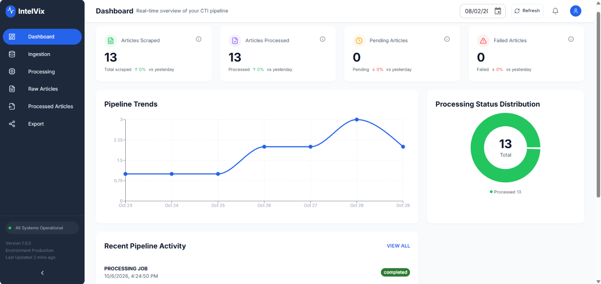
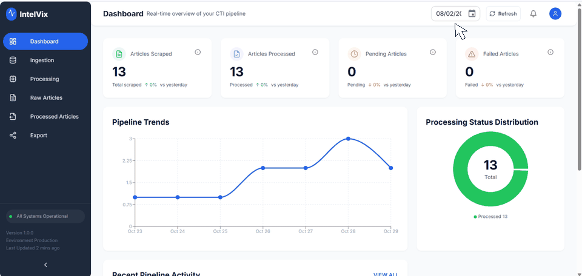
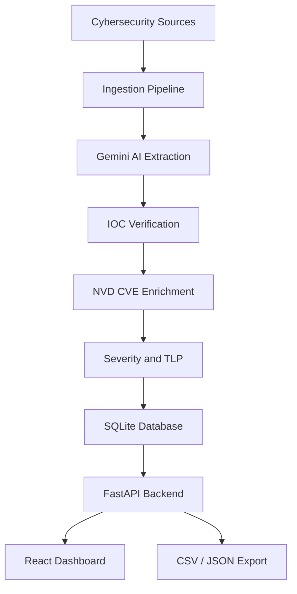

# 🛡️ IOC Pulse — AI-Powered Cyber Threat Intelligence

**Turn cybersecurity news into structured, enriched, and verifiable threat intelligence — automatically.**

IOC Pulse is an open-source CTI pipeline that ingests cybersecurity articles, extracts IOCs and threat entities using Gemini, enriches CVEs through the NVD, and verifies extracted intelligence against source text.

**🚀 Self-hosted · No GPU required · No cloud database required**

[](https://python.org)
[](https://fastapi.tiangolo.com/)
[](https://react.dev/)
[](https://www.docker.com/)
[](LICENSE)

---
## 📸 Demo





---


## ✨ Features

- 🌐 **Automated Ingestion** — Collect threat intelligence from 14+ configured cybersecurity sources.
- 🧠 **AI-Powered Extraction** — Identify IOCs, CVEs, malware, threat actors, and MITRE ATT&CK techniques.
- 🔍 **Source-Grounded Verification** — Check extracted entities against source text to help identify unsupported results.
- 📊 **CVE Enrichment** — Retrieve available CVSS scores, severity, vectors, and descriptions from NVD.
- 🏷️ **Threat Classification** — Classify severity and assign TLP metadata.
- 🔄 **Model Fallbacks** — Retry supported transient failures and use configured fallback models.
- 🕐 **Daily Automation** — Optionally schedule ingestion.
- 📤 **CSV / JSON Export** — Export processed intelligence.
- 🗄️ **Local-First Storage** — SQLite database with Docker Compose deployment.

## 🔄 How It Works

1. **Ingest** — Collect articles from supported cybersecurity sources.
2. **Extract** — Use Gemini to extract structured IOCs, CVEs, malware, threat actors, and MITRE ATT&CK techniques.
3. **Verify** — Cross-check extracted entities against source text and filter results according to verification logic.
4. **Enrich** — Retrieve available CVE information from the NVD.
5. **Classify** — Assign severity and TLP metadata.
6. **Store & Serve** — Persist results in SQLite, expose APIs through FastAPI, and display intelligence in React.

## 🏗️ Architecture



## 🚀 Quick Start

**Prerequisites:** Docker Desktop or Docker Engine with Compose, Git, and a [Gemini API key](https://aistudio.google.com/apikey).

### 1. Clone the repository

```bash
git clone https://github.com/YOUR_GITHUB_USERNAME/IOCPulse.git
cd IOCPulse
```

Replace `YOUR_GITHUB_USERNAME` with your actual GitHub username before publishing this README.

### 2. Configure environment variables

```bash
cp .env.example .env
```

On Windows PowerShell:

```powershell
Copy-Item .env.example .env
```

Add your Gemini credentials to `.env`:

```env
GEMINI_API_KEY=your_api_key
GEMINI_MODEL_NAME=gemini-3.1-flash-lite
```

Use a model identifier supported by your Gemini API account.

### 3. Launch

```bash
docker compose up --build -d
```

| Service | URL |
|---|---|
| Dashboard | http://localhost:3000 |
| API documentation | http://localhost:8000/docs |
| Health check | http://localhost:8000/health |

### 4. Run the pipeline

1. Open **Ingestion** and select sources.
2. Start ingestion.
3. Open **Processing** and start extraction.
4. Review processed articles and intelligence.
5. Export results as CSV or JSON.

## ⚙️ Configuration

Configure the application through `.env`. Check `.env.example` for the exact variables and defaults supported by your version.

| Variable | Purpose |
|---|---|
| `GEMINI_API_KEY` | Required Gemini API key |
| `GEMINI_MODEL_NAME` | Primary extraction model |
| `GEMINI_FALLBACK_MODELS` | Comma-separated alternatives, e.g. `gemini-2.5-flash,gemini-2.5-flash-lite` |
| `LLM_BATCH_SIZE` | Processing batch size |
| `ENABLE_SCHEDULER` | Enable or disable scheduled ingestion |
| `SCHEDULER_HOUR_UTC` | Daily schedule in UTC |
| `NVD_API_KEY` | Optional NVD API key |
| `DB_PATH` | SQLite database path |
| `LOG_LEVEL` | Logging verbosity |

See the [NVD API documentation](https://nvd.nist.gov/developers) for current rate limits.

## 🗂️ Project Structure

```text
IOCPulse/
├── backend/                          FastAPI + APScheduler
│   ├── app/
│   │   ├── config/                   Settings + CORS
│   │   ├── models/                   Job state enums
│   │   ├── routers/                  API endpoints (articles, jobs, dashboard, export, sources)
│   │   ├── schemas/                  Pydantic request/response models
│   │   ├── services/                 Business logic (DB, articles, jobs, adapters)
│   │   ├── utils/                    Response helpers, CVE shim, exceptions
│   │   ├── dependencies.py           FastAPI dependency injection
│   │   └── main.py                   App entry point + scheduler lifecycle
│   ├── Dockerfile
│   └── requirements.txt
│
├── frontend/                         React 18 + Vite + MUI
│   ├── src/
│   │   ├── api/                      Axios clients (articles, dashboard, jobs, export)
│   │   ├── components/               UI components (Dashboard, Ingestion, Processing, ...)
│   │   ├── hooks/                    React Query hooks
│   │   ├── pages/                    Route pages (Dashboard, Ingestion, Processing, ...)
│   │   ├── theme/                    MUI theme + palette
│   │   ├── App.jsx                   Route definitions
│   │   └── main.jsx                  App entry point
│   ├── Dockerfile
│   └── package.json
│
├── src/                              Python pipeline core
│   ├── core/
│   │   ├── config.py                 Pydantic settings (env-driven)
│   │   ├── exceptions.py             Custom exception hierarchy
│   │   └── orchestrator.py           Module 1 → Module 2 CLI runner
│   ├── module_1_ingestion/           Scraping + parsing
│   │   ├── article_parser.py         HTML → structured article
│   │   ├── dynamic_renderer.py       Playwright fallback
│   │   ├── index_parser.py           RSS + index link extraction
│   │   ├── models.py                 RawArticle dataclass
│   │   ├── source_manager.py         Orchestrates sources
│   │   ├── temporal_filter.py        Date range filtering
│   │   └── run_ingestion.py          CLI entry point
│   ├── module_2_llm_processing/      Gemini + verification
│   │   ├── llm_client.py             Env-driven Gemini client
│   │   ├── models.py                 IOCCollection, ThreatMetadata, ProcessedArticle
│   │   ├── processor.py              Main extraction pipeline
│   │   └── verification.py           Anti-hallucination scoring
│   ├── module_last/                  Legacy export utilities
│   ├── utils/                        CVE enrichment + retry helpers
│   └── shared/
│       ├── database.py               Async SQLite client + auto-migration
│       └── logging_middleware.py     JSON formatter
│
├── data/                             SQLite DB (git-ignored, created at runtime)
├── docs/
│   └── demo.mp4                      Demo video (see README)
│
├── docker-compose.yml                Two-service local deployment
├── .env.example                      Environment template
├── .gitignore
├── .dockerignore
├── LICENSE
└── README.md

## 🛠️ Common Commands

```bash
# Start / stop
docker compose up -d
docker compose down

# Rebuild after code changes
docker compose up --build -d

# View backend logs
docker compose logs -f backend

# Check service status
docker compose ps

# Check health
curl http://localhost:8000/health

# Run ingestion manually
docker compose exec backend python -m src.module_1_ingestion.run_ingestion

# Process up to 5 articles
docker compose exec backend python -m src.module_2_llm_processing.processor --limit 5

# Inspect processed article count
docker compose exec backend python -c "import sqlite3; c=sqlite3.connect('/app/data/ioc_pulse.db'); print('Processed:', c.execute('SELECT COUNT(*) FROM processed_articles').fetchone()[0]); c.close()"
```

Manual commands assume the documented module entry points, database path, and table name match your current configuration.

## 🔐 Security Notes

- Keep API keys in `.env`; never commit secrets.
- SQLite data remains local when configured with the appropriate persistent mount.
- Gemini and NVD integrations require external network access.
- Source-text verification helps reduce extraction errors but does not guarantee correctness.
- Severity and TLP labels require review; TLP metadata does not enforce access control.
- Do not expose the API publicly without appropriate authentication and authorization.

## 🗺️ Roadmap

- [ ] Authentication and TLP enforcement
- [ ] STIX 2.1 export
- [ ] Cross-article IOC correlation
- [ ] Export history
- [ ] Expanded automated testing

## 🤝 Contributing

IOC Pulse is an independent open-source engineering project. Bug reports, feature requests, and contributions are welcome.

1. Fork the repository.
2. Create a feature branch.
3. Test and document your changes.
4. Submit a pull request.

## 📜 License

Released under the [MIT License](LICENSE).

---

**Built independently for security analysts and engineers who want AI-powered threat intelligence without the operational overhead.**

⭐ If you find IOC Pulse useful, consider starring the repository and sharing it with the cybersecurity community.
